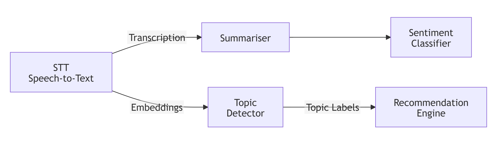

# ASSESSED ADVANCED TASK 1/3: AI Model-Interaction Graph Transfer System

Modern AI ecosystems rely on networks of interconnected models that exchange embeddings, predictions, prompts, and intermediate representations. Your task is to design a subsystem that models interactions between AI components as a **directed graph**, where each AI model, agent, or processing module is represented as a **node**, and each flow of information — such as a prompt handoff, embedding transfer, or inference request — is represented as a **directed edge**. Each edge contains metadata such as **latency, payload size, confidence score, and transformation type**.

Your system must support:

- creating this graph,
- dynamically updating it as new AI components become available,
- simulating how data is transferred through the graph by following edges from one model to another.

This simulation should reflect how real AI pipelines route information — for example, a speech-to-text model sending output to a summariser, which then forwards results to a sentiment classifier. In addition, your system must **serialise the graph into a portable format** such as JSON, YAML, XML, or Pickle.

## Example AI-interaction graph

To illustrate the structure you will be working with, consider the following simplified AI-interaction graph. A **Speech-to-Text (STT)** model sends its transcription to a **Summariser**, which forwards a condensed version to a **Sentiment Classifier**. Meanwhile, the STT model also sends raw embeddings to a **Topic Detector**, which then forwards topic labels to a **Recommendation Engine**.

Your system must be able to simulate data transferring through this graph, for example starting at the STT model and determining:

- all reachable modules,
- the most efficient processing path (e.g. by latency),
- the highest confidence route for a given task.

## Your task

Your Assessed Advanced Task is to complete the system using **Python or C++**, and include the core features above, as well as **your own function or any one of the four functions** listed below:

- ⭕ **delta-based graph exchange** — so that only incremental updates are transmitted;
- ⭕ building a **threat-propagation simulation engine** that models probabilistic spread;
- ⭕ performing **cross-region graph merging** to reconcile conflicting updates; and
- ⭕ generating **real-time graph-based alerts** based on metrics such as centrality, cycle detection, or sudden changes in node connectivity.
