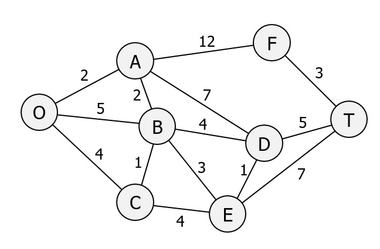

# ASSESSED ADVANCED TASK 2/3: Visitor Route Optimisation at the China Museum Of The South China Sea Using Dijkstra's Algorithm

The China Museum Of The South China Sea is laid out as a network of interconnected galleries, viewing decks, educational zones, and visitor facilities. Each location can be represented as a **node**, and the walking time or distance between them can be represented as a **weighted edge**. Museum planners want to analyse how visitors move through the building so they can optimise signage, reduce congestion, and improve accessibility. To support this, you will complete an implementation of **Dijkstra's shortest-path algorithm** to compute the most efficient routes between key museum locations.

The partially completed Python program provided on Aula models this museum layout as a weighted graph. Your task is to finish the Dijkstra implementation so that the system can:

- ⭕ determine the shortest walking route between two museum areas (e.g., from the Entrance to the Maritime Silk Road Gallery),
- ⭕ identify which areas are reachable from each starting point,
- ⭕ and analyse visitor flow patterns across the entire building.

This transforms Dijkstra's algorithm from a purely theoretical exercise into a practical tool for museum visitor-flow optimisation.

Either by creating the C++ code from scratch or using the partially completed Python program provided on Aula in the folder **DIJKSTRA-CODE-ADV-TASK-2**, complete the implementation of the Dijkstra shortest-path algorithm so that it correctly processes the input graph provided. The graph represents a weighted network of museum locations, where each node corresponds to a gallery or facility, and each edge weight represents the walking distance or travel cost between them. Your task is to ensure that the algorithm computes the shortest path from a chosen start location to a chosen end location.

> **If you are using the provided Python code:** You must complete the missing section of the code where indicated (`### COMPLETE CODE HERE ###`).

## Required outputs

Your final implementation must produce the following outputs for the graph shown in the image:

- ⭕ **The list of explored nodes** — nodes permanently removed from the unvisited set.
- ⭕ **The list of ignored nodes** — nodes that were considered during relaxation but not selected as the next smallest.
- ⭕ **The full distance table after each iteration** of the algorithm, showing the current best-known distance to every node at every step. This table must update dynamically as the algorithm progresses, allowing you to demonstrate that your implementation is functioning correctly at each stage.
- ⭕ **The shortest path and its total cost**, for example:

```python
(['O', 'A', 'B', 'D', 'T'], 13)
```

- ⭕ **A reachability matrix for the graph.** This matrix must be produced using your completed Dijkstra implementation (i.e., by running the algorithm from each node in turn). A reachability matrix is a table showing, for every node in the graph, which other nodes are reachable from it. For each pair of nodes:
  - ⚫ place **1** if the end node is reachable from the start node
  - ⚫ place **0** if it is not reachable

## Your own additional graph

Once your program works for the graph in the image, you must create **at least one additional weighted graph of your own design (with more than 6 nodes)** and generate for your additional graph:

- ⚫ explored nodes
- ⚫ ignored nodes
- ⚫ shortest path and cost
- ⚫ reachability matrix

## Graph Museum Floor Plan



| Node | Museum Location |
|------|-----------------|
| O | Entrance / Orientation Hall |
| A | Ancient Maritime History Gallery |
| B | Shipwrecks & Archaeology Exhibit |
| C | Coral Reefs & Marine Life Zone |
| D | Navigation & Technology Gallery |
| E | Exploration & Trade Routes Exhibit |
| F | Cultural Exchange Gallery |
| T | Temporary Exhibition Hall / Exit Area |

## Additional functions

You must also implement **two additional advanced functions** that extend the analytical capability of your Dijkstra program. This could include, but is not limited to:

- ⭕ a full **path-reconstruction table**;
- ⭕ an **all-pairs shortest-path matrix** using repeated Dijkstra;
- ⭕ a **relaxation-change tracker**;
- ⭕ a **priority-queue-based Dijkstra variant**;
- ⭕ an **unreachable-subgraph detector**;
- ⭕ **edge-relaxation statistics**;
- ⭕ a detailed **ASCII trace** of each iteration.

## CODE

```python
from collections import defaultdict
import sys

class Graph():
    def __init__(self, size):
        self.edges = defaultdict(list)                              #dictionary of all connected nodes e.g. {'X': ['A', 'B', 'C', 'E'], ...}
        self.weights = {}                                           #dictionary of edges and weights e.g. {('X', 'A'): 7, ('X', 'B'): 2, ...}
        self.size = size
        self.dist = []
        for i in range(size):
            self.dist.append(sys.maxsize)
        self.previous = []
        for i in range(size):
            self.previous.append(None)
        
    
    def add_edge(self, from_node, to_node, weight):                 #bidirectional
        self.edges[from_node].append(to_node)
        self.edges[to_node].append(from_node)
        self.weights[(from_node, to_node)] = weight
        self.weights[(to_node, from_node)] = weight


    def findSmallestNode(self): 
        smallest = self.dist[self.getIndex(self.Q[0])]
        result = self.getIndex(self.Q[0])
        for i in range(len(self.dist)):
            if self.dist[i] < smallest:
                node = self.unpoppedQ[i]
                if node in self.Q:
                    smallest = self.dist[i]
                    result = self.getIndex(node)
        return result
            

    def getIndex(self, neighbour):
        for i in range(len(self.unpoppedQ)):
            if neighbour == self.unpoppedQ[i]:
                return i


    def getPopPosition(self, uNode):
        result = 0
        for i in range(len(self.Q)):
            if self.Q[i] == uNode:
                return i
        return result


    def getUnvisitedNodes(self, uNode):
        resultList = []
        allNeighbours = self.edges[uNode]
        for neighbour in allNeighbours:
            if neighbour in self.Q:
                resultList.append(neighbour)
        return resultList          


   def dijsktra(self, start, end):                                 
        self.Q = []
        for key in self.edges:
            self.Q.append(key)
        for i in range(len(self.Q)):
            if self.Q[i] == start:
                self.dist[i] = 0
        self.unpoppedQ = self.Q[0:]

        while self.Q:                                                       
            u = self.findSmallestNode()                                     
            if self.dist[u] == sys.maxsize:
                break                                           
            if self.unpoppedQ[u] == end:
                break

            uNode = self.unpoppedQ[u]


        ### COMPLETE CODE HERE ###

            
        shortest_path = []
        shortest_path.insert(0, end)
        u = self.getIndex(end)                                                  
        while self.previous[u] != None:
            shortest_path.insert(0, self.previous[u])                           
            u = self.getIndex(self.previous[u])
        return shortest_path


graph = Graph(8)


edges = [
    ('O', 'A', 2),
    ('O', 'B', 5),
    ('O', 'C', 4),
    ('A', 'B', 2),
    ('A', 'D', 7),
    ('A', 'F', 12),
    ('B', 'C', 1),
    ('B', 'D', 4),
    ('B', 'E', 3),
    ('C', 'E', 4),
    ('D', 'E', 1),
    ('D', 'T', 5),
    ('E', 'T', 7),
    ('F', 'T', 3),
]
    

for edge in edges:
    graph.add_edge(*edge)


print(graph.dijsktra('O', 'T'))
```
