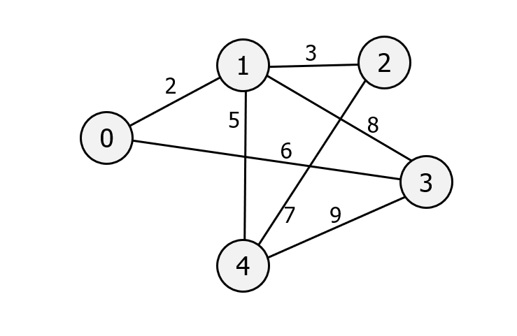

# ASSESSED STANDARD TASK 4: Implement Prim's Algorithm

You can either develop the program from scratch in C++ or use the Python code provided on Aula in the PRIMS-STD-TASK-4 folder. The program should implement **Prim's Algorithm** and correctly generate the **Minimum Spanning Tree (MST)** for any valid weighted graph.

You must use the graph shown below as one of your test cases to verify that your implementation produces the expected MST.



## Your completed code must produce the following output

```text
Prim's Algorithm Result
Edge    Weight
0 – 1       2
1 – 2       3
1 – 4       5
0 – 3       6

MST Adjacency Matrix
   | 0  1  2  3  4
------------------
0 | 0  2  0  6  0
1 | 2  0  3  0  5
2 | 0  3  0  0  0
3 | 6  0  0  0  0
4 | 0  5  0  0  0
```

## Additional function

You must also implement **one additional MST-related function** to extend your solution. This could include, but is not limited to:

- ⭕ implementing a function to compute the **"second-best" Minimum Spanning Tree**;
- ⭕ adding a function that **detects cycles** within the MST to verify correctness;
- ⭕ extending your implementation to correctly handle graphs that contain **negative edge weights**.

## SUPPORT CODE

```python
import sys                                                      #needed for maxsize
  
class Graph(): 
  
    def __init__(self, vertices):                               #implements graph as adjacency matrix
        self.V = vertices                                       #number of vertices
        self.graph = [[0 for column in range(vertices)]         #adjacency matrix with no edges (all connections set to zero)
                    for row in range(vertices)] 
  
    def printMST(self, parent): 
        print ("Edge \t Weight")
        for i in range(1, self.V): 
            print (parent[i], "-", i, "\t", self.graph[i][ parent[i] ])
  
                                                                #from reached nodes find the unreached node with the minimum cost
    def minKey(self, key, mstSet): 
        min = sys.maxsize                                       #set min to infinity (use maxsize which is next best thing!)
        for v in range(self.V):                                 #count through number of vertices
            if key[v] < min and mstSet[v] == False:             #if vertex is less than min and unreached
                min = key[v]                                    #assign to min 
                min_index = v                                   #min_index is position of min in key
        return min_index                                        #return min_index
  
                                                                #find MST 
    def primMST(self): 
        key = [sys.maxsize] * self.V                            #initialise key to list of values all set to infinity; same length as self.V              
        parent = [None] * self.V                                #list for constructed MST 
        key[0] = 0                                              #set first element of key to zero (this is where we start)                                                                                   
        mstSet = [False] * self.V                               #mstSet is list of booleans set to False
        parent[0] = -1                                          #first element of parent list set to -1                        
  
        for vertex in range(self.V):                            #go through all vertices
            u = self.minKey(key, mstSet)                        #call minKey; minKey returns u (index of unreached node) 
            mstSet[u] = True                                    #mstSet at index of node is set to True                                                                                                
            for v in range(self.V):                             #go through all vertices
                
                                                                #if edge from u to connected node v is > 0 (if there is an edge)
            ### COMPLETE CODE HERE; FULL COMMENTS TO            #and mstSet[v] is unreached 
            ### THE RIGHT                                       #and key[v] is greater than the edge cost
                                                                #(only if the current edge cost is greater will need to change)
                                                                #key[v] takes edge cost


                    parent[v] = u                               #parent[v] is index of node; so list of parents (nodes) is the MST
  
        self.printMST(parent)                                   #print the list of parents, i.e. the MST                                
  
g = Graph(5) 
g.graph = [ [0, 2, 0, 6, 0], 
            [2, 0, 3, 8, 5], 
            [0, 3, 0, 0, 7], 
            [6, 8, 0, 0, 9], 
            [0, 5, 7, 9, 0]] 
  
g.primMST();
```
